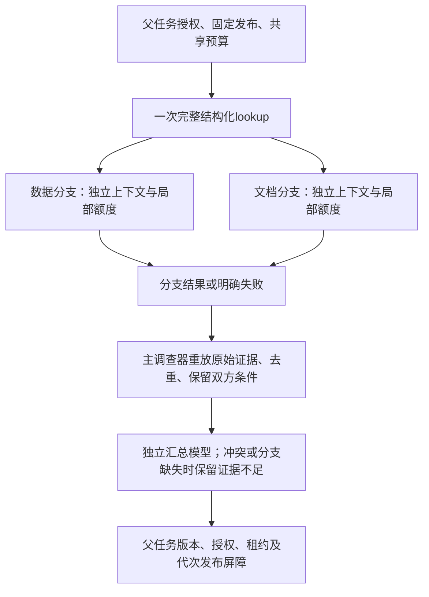

# P1-12：按需委派、并行工具与矛盾聚合

依赖[P1-09调查循环](single-agent-v0.1.md)、[P1-10上下文](context-v0.1.md)与[P1-11持久执行](durable-dispatch-v0.1.md)。本模块增加内部协作策略，业务来源、证据校验、授权和最终发布仍由已有组件管理。

## 四种方法与依赖图

| Plan.investigator | 规划上下文 | 执行方式 |
| --- | --- | --- |
| fixed | 固定步骤及一次回答生成 | 按既有确定性流程执行，仍为产品默认 |
| single_agent | 一份不断重建的调查上下文 | 单个规划器依次调用工具 |
| parallel_tools | 一份调查上下文 | 单个规划器一次选择两项独立工具，两个线程执行 |
| multi_agent | 数据、文档各自独立，最后另建汇总上下文 | 两个分支独立规划，主调查器回查原文后汇总 |

`parallel_tools`的batch必须恰好含两个不同动作，最多一个search/expand；expand引用的候选必须在batch之前已存在。同批search的结果不能用于同批expand。其余动作是已固定条件的count/links。每项分别计费、记录失败；某工具超时不会抹去另一工具成功结果，也不能变成成功零记录。仅当当前可用工具与剩余额度允许时暴露batch。

## 触发与委派

`investigation/cooperation.py::trigger`只读取当前intent、允许来源数、固定关系对和服务配置。cross_source/relationship且存在多个允许来源或固定关系对时才考虑委派；关闭开关或额度不足退回单Agent。当前最低根额度为4次模型、5次工具、30000累计输入字符和1024输出单位，确保每份Allocation满足Schema；这只是可启动门槛，不保证完成调查。触发不读参考答案、评分、历史成败或测试标签。

`Delegation`包含父任务、修订、授权、epoch、release/manifest、范围、时间、输入证据ID、目标、允许工具、资源份额和完成条件。子分支在进入循环前与当前Access和FrozenContext逐项核对。数据角色只能lookup/count/links/read/finish；文档角色只能lookup/search/expand/read/finish。工具选择还必须满足当前任务前置条件。模型文字、工件或来源不能授予更多能力。

两个分支是同一父执行中的逻辑调查器，没有另建可以自行批准的用户任务。每个有独立SingleAgent、上下文归档和决策历史；共享同一模型配置及只读原文。通过copy_context传播当前有效父权限，不共享整段聊天。父任务先lookup一次，把同一证据卡及经过校验的原始工件交给双方，避免重复调查的虚假多票。

## 额度、日志与恢复

共同比较上限为8模型/10工具、单次24000及累计96000输入字符、单次2000及累计4000输出单位、900秒。四种方法相同；fixed可以只用一部分。P1-09历史6/6配置与获批请求范围不变。

| 份额 | 模型 | 工具 | 累计输入字符 | 输出单位 |
| --- | --- | --- | --- | --- |
| 数据 | 3 | 4 | 16000 | 1000 |
| 文档 | 4 | 5 | 48000 | 1500 |
| 主调查器 | 1 | 1 | 32000 | 1500 |
| 总计 | 8 | 10 | 96000 | 4000 |

主调查器的工具份额用于共享lookup；原文完整性审计单独报告次数和耗时。分支每次生成还受实际局部余额和256以上的单次输出额度约束。份额按配置确定性分割，不动态借用兄弟剩余额度；因此根额度未满时某分支也可能停止。停止必须在报告中保留，不能暗中给多Agent增加总额。

TeamBudget是线程安全的本轮逻辑计数，包含重放；数据库Journal仍负责新增实际调用的持久预留与结算。两者不能相加当作实际provider消费。数据lane=1、文档lane=2；序号各从100/200开始，主流程从0开始，batch另用确定性lane。根池及每lane的份额都在同一数据库事务检查，恢复不能再次拿满额。

恢复从已保存的模型/工具输出重建状态。指纹只规范化上下文绑定及Delegation中的epoch元数据，其他实际参数保持严格比较。汇总只引用确定性的分支语义摘要，随机run_id、计时和完整报告路径保存在私有审计中，避免它们破坏同一语义输入的恢复。分支和主模型已完成响应均可重放；原文审计仍会执行。

某分支超时后设置协作停止标记，将在途预留保守计为unknown并隔离，成功分支可继续交付。分支模型响应未知时保留待对账额度，不自动重发；主流程可基于另一分支交付不足报告。取消、失效授权或旧epoch仍阻止整个父任务正式发布。线程不能强制中断上游网络/本地库；迟到回调只能留档及结算，不加入已发布报告。逻辑资源快照记录当时预留，后续结算以持久账本为准。

## 证据与冲突

BranchResult返回有界结论、证据ID、反证、待核实项、结构化Assessment及失败状态。Assessment的supported/contradicted/unknown是模型提议，绝非语义金标准。证据别名只在各自上下文内有效；主调查器先校验报告来源、复制/核验原始工件，再按完整证据身份去重并重新映射别名。分支报告原文保留为可审计工件。

同一issue+subject出现相反判断时创建冲突表，将双方支持证据与反证强制保留进汇总上下文。主调查器独立重放原文、页/字段及必要范围上下文，不以票数决定。当前没有能自动裁定任意适用性语义的规则，冲突状态保持`unresolved_after_source_replay`，最终强制`insufficient_evidence`。任一分支缺失也强制不足。未知项取并集，不能在汇总时丢掉个车配置、因果或资料覆盖未知。

原文回放只能证明引用和来源一致，不能证明一句自然语言推论正确。最终语义审查状态仍为pending；独立人工评价是另一个验收层次。

## 本地并发的实际限制

真实资料首轮发现：冻结包校验也会打开Qdrant local，仅分开服务锁不能避免同目录双客户端冲突。`QdrantVectors`现按规范化目录使用进程内RLock，整个客户端生命周期持有，close及构造失败都释放，重复close无副作用。每个客户端应在创建线程关闭。同目录校验/向量查询排队；模型等待、独立SQL与分支规划仍可重叠。跨进程仍依赖Qdrant原生锁，冲突明确失败，没有绕过校验或自动换后端。

ArtifactStore先完整写临时文件，再以硬链接原子发布哈希对象，已存在对象逐字核验，不暴露半写文件。要求本机文件系统支持同目录硬链接；当前已在Windows本地运行验证，不代表任意网络盘兼容。没有新增依赖或迁移。

恢复、超时和并行调度的工程实测与官方资料演示见[P1-12实验记录](../experiments/P1-12-cooperation.md)。本模块不宣称多Agent质量或吞吐收益；远端向量服务/多进程吞吐优化仍须另行设计和测量。
