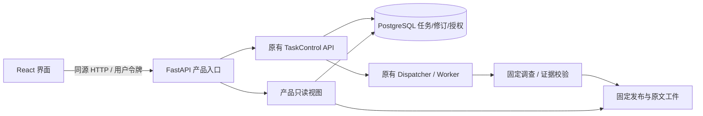

# P1-17 产品层与既有控制协议

2026-10-29。依赖 P1-16 的已交付实现和报告，并保留其未获证实的质量验收状态。

`portal` 是新增整合层，直接调用 `create_control_app` 注册原有写接口。计划修订、批准、澄清、执行、暂停、恢复、取消和记忆修改均由同一 TaskControl/MemoryService 校验。没有“界面专用宽松权限”。列表读取也按令牌映射出的 owner 过滤，不接受 JSON 中声明的 owner。

新增接口为 `/product/info`、`catalog`、`tasks`、`memories`、任务 `evidence`/`original/{alias}` 与记忆原始来源。只有不含数据的运行模式说明公开；业务读取均需认证。原文接口先验证任务所有权、报告发布、有效授权、允许来源和固定发布，再调用 `resolve_citation` 重放来源、解析配方和引用区间。接口不接受本机路径或任意来源 URL。

React 将运行终态与证据处置分开。完成状态只说明工作流返回，证据不足、来源内零匹配、待审和模拟生成仍明确呈现。引用支持、反证与必需上下文分别展示；关系卡保留完整类型/条件/未知项，而不把关系边当作因果。未配置的个车条件不被 UI 代填。

所有写入携带服务端最新 `expected_version`。批准另外绑定 question、revision、plan hash；记忆写入绑定修订与 proposal hash。冲突发生后刷新当前状态，不自动替用户重试批准。撤销或失去读取权限时清除报告与原文视图。客户端只在当前页面内存中保留访问令牌，不使用 localStorage/sessionStorage、URL 或浏览器 trace。

默认是同源静态资源与 API，服务监听本机；容器映射也限制在本机。加入同源写入检查、`no-store`、内容类型检查和 CSP，原文始终作为 React 文本渲染，不解释成 HTML 或操作指令。服务端临时会话文件只保存在忽略目录。

执行仍使用原有持久化队列和预算日志，服务进程带一个后台 worker 便于本机产品启动。任务取消、发布、恢复的原有代次和版本规则保持。暂停能恢复，取消不能原地恢复；复制取消任务产生新的任务/授权。中断执行恢复不会自动重发未知外部调用。外部模型请求已发出后无法被本机按钮保证撤回。

产品工程单独置于 `portal/` 和 `frontend/`，没有改变 P1-16 冻结的生产包、Python 依赖或原实验定义。启动时保存产品代码和构建资源指纹，浏览器验收记录实际服务返回的指纹，避免把旧服务验证误称为新代码验证。

三个模式在资料和生成上明确区分：独立合成样例、正式冻结来源配模拟生成、手工启用真实模型。前两者不会创建外部模型请求，显式故障仅为本地注入。正式演示不更改来源字段、测试标签、旧评分或实体映射。

依赖与打包：前端版本单独锁定；Python 继续使用原锁文件。前端开发、浏览器自动化和容器运行不属于模型质量实验。容器实际启动、第二位使用者体验和 P1-18 的完整干净环境/GitHub 验收分别记录，未执行的不填通过。
