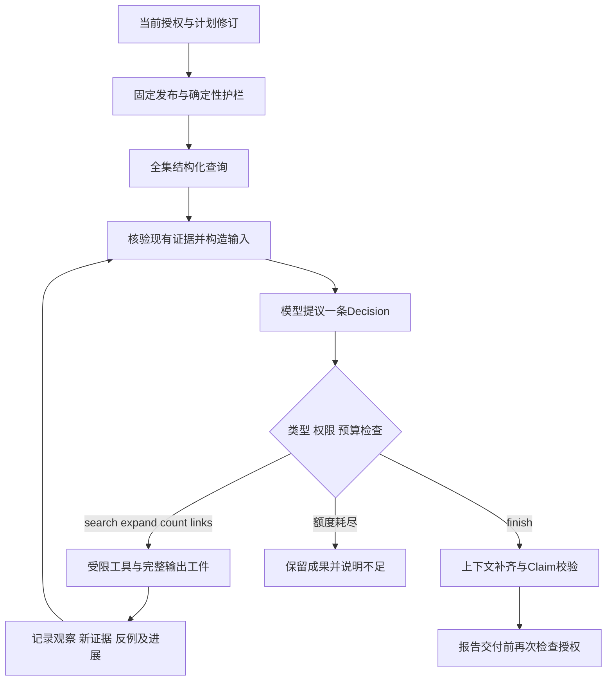

# P1-09：有边界的单Agent调查

前置：P1-07的固定发布/证据/评分和P1-08的授权与状态。本模块实现同步Plan/Execute/ReAct，不实现后台worker、多Agent、记忆或结构化摘要；P1-10～P1-18完整目标保留。

## 两层计划

Control.PlanRevision固定用户目标、车型/来源/时间、允许执行阶段和investigator。选择single_agent只改变授权内的方法，不增加工具或来源；P1-08的审批、当前修订和执行代次继续生效。

任务内planner根据工具观察维护假设、支持/反证、证据缺口和后续检查。每轮Decision保存短的、可检查的行动理由；它是决策记录，不是内部思维链或语义金标准。每次改假设都保留旧版本、变更理由及证据别名。executor执行当前Decision中唯一的工具或结束提议。

## 能力边界

Agent只可使用P1-07已有数据能力：固定来源全集lookup（程序先执行）、搜索、原文/父段/范围展开、预定义投诉去重计数、请求中固定端点的关联检查。没有浏览器、任意URL、任意SQL、代码执行或新增授权工具。统计题仅开放聚合count，避免向模型发送完整投诉叙述。

搜索结果以D001表示导航候选，包含可读来源ID、范围通道和预览，不能直接作为结论引用；expand后才有E001证据卡。模型不能构造SHA或任意document_id，未见过的候选被拒绝。include_related只对expand有效：false保留焦点及所有必要范围上下文，true额外跟随官方明确引用。固定流程与Agent使用同一PublishedService参数能力，默认策略可能不同。

决策提示采用独立的Decision协议，最终AnswerProposal仅嵌在finish.proposal；不拼接互相竞争的顶层输出要求。当前提示版本bounded-react/0.3-candidate-preconditions：无候选时不开放expand，来源ID不能代替D别名；普通调查应先执行至少一个调查工具再finish，最后一个模型调用槽位可用已有证据结束。全集零结果/历史不支持等确定性护栏不依赖候选或模型。

证据沿用原始字节/解析/分块重放和结构化查询复算，不能由模型自称supported免检。假设的supported/contradicted是模型提议，最终结论仍需语义审查。如果模型在过程里明确记录反证，answered的最终引用集合必须保留这些反证；不能静默丢掉。

Agent最终输出使用原有AnswerProposal，先补齐已经展示的传递范围上下文，再运行相同Claim校验。因果/个车确认、未知引用、范围错误、引用种类不符或非法Schema仍失败，不能包装成成功零记录。

## 公平额度与旧基线

P1-07历史默认max_model_calls=1保留。一次模型调用不可能完成多轮观察后决策，因此新增比较使用[共同额度](../../examples/single-agent-comparison.json)：工具6次、模型最多6次、每次输入24000字符、累计96000字符、每次输出最多2000tokens、累计最多4000输出tokens、两次展开、总时长900秒、同一行动最多2次、连续无进展2次、只读工具超时最多重试1次。

FixedConfig现在接受更大的模型调用上限，默认仍为1。受保护服务启动时给两种方法共同的6次上限；固定流程依然按原策略只生成一次，不能把“允许最多6次”写成“实际用了6次”。RunBudget同时用于固定流程和Agent，真实消耗单独记录。比较的新提示词投影去掉不影响调查的内部任务ID；来源ID、引用和证据内容不变，旧P1-07输入输出不覆盖。

字符预算是输入资源代理量，不是token精确预测；真实provider usage另记。生成前预留max_tokens，有真实completion_tokens时释放未用部分；缺usage或请求失败则保守保留额度，记null而不编数字。超时重试消费工具额度；模型调用不自动重试，避免未知是否计费的重复请求。

本次真实实验另用models/request_allowance.py落盘预留获批请求：全局14次，每题fixed 1次/Agent累计6次，失败和在途调用占用额度，按题/方法累计生成上限4000tokens，未知历史请求保守预留2000。文件原子替换和排他锁防止本机脚本重启/并发绕过；已有锁不自动删除。这是本次本地实验账本，P1-11服务级共享队列/租约/预算仍未实现。实际12次后停止，不消费剩余2次追求成功。

只有首轮使用完整共同上限。第二轮模型上限为5、第三轮为4，固定响应回放；第三轮Agent实际输出余额为Prius1765、车门3208。后两轮是受剩余额度限制的提示修复，不是新的独立等预算质量实验；逐题实际配置与历史错误均保留。

耗时在操作边界检查，不能强制打断已在途网络或解析。超过时长后不继续调用工具/模型，结果标明限制；不宣称已实现硬取消。独立证据审计重放次数和总耗时记录在报告中，不能隐藏Agent多轮检查开销。

## 停止与持久化

充分或无法解决时模型可finish；额度、重复、无进展停止时程序返回insufficient_evidence，保留完整工具输出、证据卡、候选、决策版本和未解决事项，不把未验证假设渲染成事实。工具完整性/授权/模型结构错误为failed，保留已发生的调用和可用工件。

P1-08在每轮、工具前后、生成前后、报告登记和事务发布处继续检查授权/修订/epoch。暂停或撤销后的迟到结果不得发布。Plan模式不调用Agent。API不接收任意工具函数或外部模型地址。

所有决策输入输出以内容哈希工件留档，run报告关联当前控制修订、发布、模型身份、提示词版本、实际资源和停止原因；文件和数据库仍没有共同事务。同步执行状态可保存，后台恢复和租约继续属于P1-11。

内容JSON解析失败时ModelCallFailed可携带原始响应内容、finish_reason、usage与身份的私有诊断；报告与缓存保留诊断，回放错误也不重新请求。首轮旧版丢失的一次usage不能逆向补造。没有记录的请求用量与费用为null，不当成0。

## 对照与审查

比较使用两道已看过开发题DEV-PRIUS-JOINT和DEV-DOOR-PAIR、同一冻结发布、DeepSeek模型ID、工具配置、额度、问题及v0.2参考。标签、实现代理评分及历史答案均不进入模型输入。私有控制ID仅在比较脚本中被规范成固定占位，规范在真实发送前和回放前同样执行，并保存实际provider输入工件，不只为命中缓存修改指纹。

正式统计区分实时API、精确保存响应回放、脚本决策及模拟回答。盲审包继续隐藏方法/模型，新增等价证据按P1-07协议处理；没有独立人工审查时正式语义指标为null。真实外部对照已获明确批准并执行12次；所选Prius Agent因输入超额返回不足，车门Agent因声明/证据类型不符失败，没有证明相同质量下的收益，fixed保留默认。

回放从不可变report_artifact读取并核对报告内容哈希，固定每题实际配置，不依赖会覆盖的reports/视图。8份已保存响应、0新增请求重现成功及失败结果；不能把回放验证通过当作Agent语义通过。详见[全部轮次和开销](../experiments/P1-09-single-agent.md)、[机器摘要](../experiments/P1-09-results.json)与[实现代理草稿](../experiments/P1-09-review-draft.md)。完整上下文造成的超限留待P1-10按原计划处理，不删条件或扩大额度掩盖负结果。
