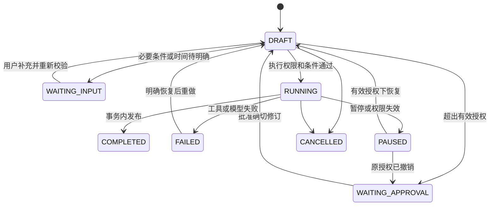

# P1-08：授权、计划修订和持久化任务状态

本模块依赖P1-01的工程/数据库及P1-07固定调查。原计划P1-00～P1-18保留，P1-09自主规划和P1-11后台恢复尚未实现。这里的Plan Mode是项目产品中的计划阶段，不切换Codex本身的会话模式。

## 两条独立的版本线

Authorization声明允许的发布、来源、车型/配置/日期范围、时间和操作集合。PlanRevision声明当前调查问题、假设、步骤及所需范围。修改假设不自动创建授权；合法缩小范围也可以继续使用原授权。移除或改动一个已批准的限制、增加来源、更换发布、从PLAN进入EXECUTE都会重新比较范围，需要新授权时进入WAITING_APPROVAL。

根任务的明确、完整、经认证用户提交可以建立对应授权：PLAN只包括research；EXECUTE包括research/generate/publish。缺关键业务条件或请求时间不能由冻结发布满足时先WAITING_INPUT，不给空年款等字段建立通配授权。澄清完整后，由用户的认证答案建立已明确范围的授权。撤销的旧授权不会因为恢复、修订、答案或文件文字变成有效；必须对当前确切修订作新的批准。

`scope_within()`是保守的约束比较：品牌/车型/年款/召回号/部件/生产日期已有精确限制时只能保留，允许增加更窄条件；配置键值必须保留。它不是自然语言蕴含或通用日期集合计算。额外条件缺少资料时，P1-07仍可能返回pending/不足。

## 状态与执行代次

完整合法转换由`control/contracts.py`唯一维护。COMPLETED、CANCELLED不接受重新执行；完成后仍允许撤销授权并拒绝后续报告读取。任务质量单独保存在quality，COMPLETED可以伴随insufficient_evidence和semantic_review=pending，不能当作调查语义通过。

version用于客户端乐观并发检查，每个状态/计划事件递增；epoch用于废弃旧执行凭证，在修订、暂停、撤销、取消、恢复和失败后递增。恢复后的新执行不能接受旧代次的迟到结果。一次同步执行持有服务签发的随机秘密，数据库只保存哈希；请求体不接收Access对象、执行秘密或自称批准的字段。

## 持久化结构

0005迁移新增六表：control_tasks当前指针/状态，control_revisions不可变计划，control_authorizations授权历史及撤销时间，control_questions问题与确切修订/代次绑定，control_executions执行凭证哈希和私有工件指针，control_events有序审计。

计划和授权正文分别取内容哈希；批准同时核对question_id、revision_id、plan_sha256、expected_version、epoch和当前状态，不接受旧问题或旧批准。答案也固定问题、版本和代次，答案写入与新修订处于同一数据库事务。审计记录状态前后值、修订、授权和代次，不保存用户Bearer令牌或执行秘密。

P1-06的release_tasks仍表示不可变资料绑定和保留引用。本模块每个修订使用私有CT-标识绑定相同固定发布，任务公开ID和P1-07内部绑定ID分开；新计划不能重写旧绑定。完成或取消后关闭已创建绑定，发布的报告引用继续保留出处。关闭绑定与任务提交不是共同事务，故障时可能多保留旧pin；不会据此宣称跨文件/数据库自动恢复已完成。

## 执行层拦截

- 受保护API只暴露认证后的提交、查看、修订、澄清、批准、研究、执行、暂停/恢复/撤销/取消、报告和历史接口。用户身份来自服务配置的Bearer凭证映射，不来自请求体owner_id。
- `Catalog.task/bind/reference/finish`、`PublishedService.query/count/links`、`FixedInvestigator.run`及模型调用前后检查受管理任务的有效授权、当前修订、状态和代次。数据层查到私有绑定但缺少服务上下文就拒绝；猜公开任务ID也不能冒充私有绑定。
- Plan Mode只读研究固定资料并保存计划；固定调查的正式生成入口要求EXECUTE和run凭证。模型/文档中的文本不能签发该凭证或写控制表。
- 每次长工具调用之后使用新READ COMMITTED事务复核。模型已经发出的请求可能继续完成，但返回的原始响应及用量只存私有工件；撤销后不渲染为可用答复、不登记新的正式交付。
- 最终发布与撤销使用相同PostgreSQL目录事务锁串行化。如果撤销先提交，旧执行不能发布；如果发布先提交，后续撤销阻止继续读取交付。已被用户取得的字节不能回收。

P1-03原始查询、P1-05原始检索、P1-06/07发布演示API默认关闭业务路由；历史回归须显式`development_mode=True`。这种部署是可信本机操作员打开的开发边界，不是授权产品入口。即便打开，受管理任务仍必须通过数据层检查。模拟demo仅使用合成数据，不能访问真实发布。

服务端Python进程、数据库管理权限、原始资料文件及本机操作员处于信任边界内。本模块不声称防住持有数据库/文件权限的人修改Python或复制公开资料；也未实现OAuth、组织身份、公开互联网部署或文件系统级多租户隔离。Bearer配置由本机环境提供，模型凭证的`.env`白名单不读取此配置。

## 子任务约束

认证用户创建子任务时，只能使用同一owner下父任务允许的更窄发布/来源/范围/操作，并保存parent_revision_id、parent_grant_id和parent_epoch。执行时递归检查最多8层祖先。父任务的暂停/恢复、改计划、撤销/换授权会废弃旧子任务继承关系；不偷偷重新挂到新授权，用户应创建当前授权下的新子任务。父任务取消会把未结束子任务标CANCELLED，并中断其执行代次。

父任务结束后不能再派生或执行旧子任务。已合法发布的子任务报告可以在父授权仍有效且谱系未变时读取；父授权撤销后拒绝读取。此模块实现继承约束和API，不启动自动委派或多Agent。

## 当前执行与恢复边界

本轮仍是同步执行。任务、问题、计划、授权、执行状态在服务重建后保留，但进程中断后的RUNNING不会自动续跑。用户可以明确暂停/恢复，再按新代次从头执行；不能把这称为worker断点恢复或在途网络请求取消。租约、后台调度、预算扣减、幂等提交和自动恢复继续留在P1-11。授权检查对模型提示注入的抵抗通过受控测试证明控制面没有变化，不证明模型一定忽略了所有恶意语义。
