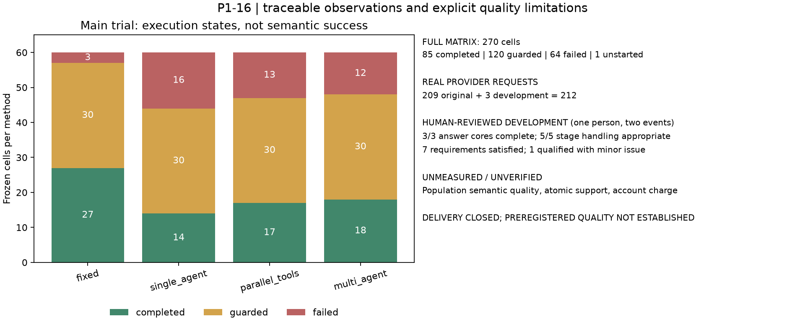

# P1-16 最终交付：综合评测、消融与失败归因

P1-16的工程实现、已授权实验、失败归因与报告交付收尾。**模型质量门槛未获证实，原计划全部质量要求没有被标记为通过。** 本报告保留负结果、未测量指标和实验顺序缺口，不通过继续调用直到出现好结果来“完成”模块。

[机器交付评估](../verification/2026-10-29-P1-16-delivery.json)分别记录`module_delivery_complete=true`、`all_original_quality_requirements_passed=false`与`formal_model_quality_acceptance=not_established`。前者仅指本轮实现/实验/报告产物交齐；它不代表原子指标已审完、数值目标已预先注册或新确认性实验已经执行。所有完整目标仍保留，未证明的目标见本页末尾。

## 核心观察

原冻结实验270格保留85 completed、120 guarded、64 failed、1 not_started，不能把269份观察补成270次实际运行。四个主方法同一60任务/10事件簇、相同模型与根上限，实际用量另计。新增开发小试8项均有实际人工评价，原生命周期5 completed/3 WAITING_INPUT保持。

| 主方法 | 执行完成 | 条件/时间等待 | 失败 | 实际请求 |
| --- | ---: | ---: | ---: | ---: |
| 固定流程 | 27 | 30 | 3 | 16 |
| 单Agent | 14 | 30 | 16 | 37 |
| 并行工具配置 | 17 | 30 | 13 | 48 |
| 多Agent策略 | 18 | 30 | 12 | 52 |

表中完成是程序执行状态，不是独立语义成功率。原批209次provider请求包含202次正常解析和7次截断解析失败，usage完整；开发小试3次正常解析，18949 tokens。P1-16这两批合计212次，新交付核查新增0次；P1-09旧12次单独保留，未移用任何剩余额度。实际账户费用未核验，继续null；挂牌费率情景与实际账单不混为一谈。



[PDF图](P1-16-delivery-figures/12599f9e7985/overview.pdf)可独立导出。原质量—费用图继续保留空的未测量面板，未将null画成0。

## 逐项交付与证据

| 原计划内容 | 实际产物与观察 | 结论边界 |
| --- | --- | --- |
| 四方法公平主比较 | 240格、完整根预算/逐格日志/输入响应，见原实验与交付JSON | 固定顺序、一次重复，未证明质量优劣 |
| 检索消融 | 四种方法各20查询，共80条本地ONNX/Qdrant轨迹，本轮逐一重验哈希 | Gold为实现代理构造，保留未匹配必需单元，不替代答案语义 |
| 上下文消融 | 3配置×2任务=6格，全部执行失败，保留上下文构造与预算记录 | 不能从失败后较短耗时推断摘要收益 |
| 冻结/顺序记忆 | 各8格；冻结8格失败，顺序1完成/6失败/1前置阻断未运行 | 声明、历史、Skill采用与准备开销分开；无通用记忆收益结论 |
| 故障恢复与外部干扰 | 11类声明挑战，本轮491项离线+204项真实PostgreSQL回归中重新找到对应通过记录 | 故障/恶意文本及模型行为含明确合成替身，不是未知攻击绝对保证 |
| 人工可复核评分 | 原测试1份，历史开发1份，当前开发8项；精确报告/来源/阅读版身份绑定 | 同一学习者，范围有限；不混合不同集合为总体成功率 |
| 资源、统计与图表 | 逐格资源、簇等权配对统计、原质量费用图、最终概览PNG/PDF | 未审质量和未知账单留空，缺配对不报质量区间 |
| 学习与复现 | 学习笔记、失败复盘范例、只读核查入口、完整验收记录 | 干净机器公开工件打包和GitHub发布属于后续P1-18 |

四种检索的簇均Recall@6均为0.15；nDCG@6分别约0.14837、0.15、0.15、0.15。很低的覆盖与映射/pending问题保留，不能先筛掉gold掩盖错误。默认hybrid不因本轮差异而调整。

并行工具27份可见报告的已记录batch为0。多Agent只有8题实际委派、16分支中7次JSON截断、9次输入预算停止；不能把“允许并行”或“分支状态completed”自动说成有效调查。固定流程继续是默认策略，未证明收益的机制仍实现、可选、保留实验负结果。

## 指标覆盖与不能推断的内容

[组件转录](../verification/2026-10-29-P1-16-component-review.json)将三份当前开发答案的24个引用对分开：23个直接支持方面、1个纯上下文。人类对这些明确方面的支持判断均为支持，但它不是整条复合句逐引文支持率；联合调查certain省略仍保留。原测试样例的直接方面支持13/15、纯上下文5个继续按其原口径保存，不与开发样例拼成全批指标。

| 指标 | 已测量部分 | 仍未知/未满足 |
| --- | --- | --- |
| Recall/nDCG | 80条固定gold检索轨迹 | Gold语义等价的全面独立审查 |
| 引用支持 | 实际人类指定方面、直接/上下文角色与覆盖 | 全270格统一语义率、整句逐引文全断言支持率 |
| 无依据断言 | 精确span/覆盖/分母校验代码与测试 | 全部原子断言的独立逐项语义标注；率为null |
| 关系判断 | 五类关系规则、原始关系卡、Ford人工整体判断 | 全测试关系逐类正确/错误/漏判的完整独立分母 |
| 任务完成 | 开发3份核心完成、5项相应阶段处理合适；7满足/1有保留 | 不把这些混为严格全部义务100%，不外推其他车型/方法 |
| 澄清/拒答 | 开发缺条件/历史/不足/有限零匹配五项均实际判合适 | 原测试全体不必要停止/拒答比例 |
| 恢复 | 声明故障的正常/恢复/关闭恢复/未知模型响应分别测试 | 未触发或未知场景的普适可靠性 |
| 成本/时延 | 实际请求、完整token/缓存字段、准备/全程耗时与配对差 | 实际账户扣费、未计时人工有效工作时间 |

这些未知不改成0或通过；指标实现与测量覆盖分别列出。程序保护证据契约不是独立语义证明。暂停澄清合适也不意味着个车调查或历史重建已经完成。

## 数值目标和实验顺序的结论

开发审查已形成有范围说明的基线，数值草案为：处置合适1.0、生成核心簇均1.0、生成无保留条件类别簇均0.75、停止阶段合适1.0。0.75按两个事件簇等权，不混入5个较容易的停止任务。它们保留为供新协议定稿的草案；原子/完整引用/严格任务门槛尚无足够独立测量，不能凭空补成数值。

原270格测试在独立开发数值基线建立前已运行，**这一顺序要求未满足**。后续人类审查与草案不能追认旧实验为预先注册的质量验收。新的确认性未见实验未运行。若后续要宣称预注册模型质量达标，必须先补齐组件标注/目标、固定新的数据与协议，再在明确调用授权下实际执行，保留这次实验。此要求持续追踪，不因本轮报告收尾而删去或标通过。

P1-16原模块的日志可追溯、测试不调参、负结果与默认策略、人工可复核等交付项已经完成；模型质量认证保持未获证实。本次收尾不是承诺所有计划质量要求已通过，也不为达到某个分数无限扩大调用。

## 练习参考答案与失败复盘

单Agent相对固定流程的簇均端到端耗时差约-19.27秒，区间约[-25.08,-13.91]秒；同时执行完成14而非27，失败16而非3，实际请求37而非16。合理结论是本组观察到较短耗时，同时有更多提前失败；没有配对人工质量与核验账单，不能称更快、更便宜且更好。固定顺序/缓存/负载也限制因果解释。

复盘`single_agent:TEST-14V047000-FACTS:1`：原报告哈希`72403ee439896d19ae0f03ed91021255af416b39c653e2e075ce613cd54c82eb`保留ValueError；事后纯本地谓词重放与错误轨迹见分析补充。需要分别核对结构化scope、证据通道、原始响应与输入可见性，不凭笼统错误码猜测所有任务同一原因。另一未运行顺序格没有观察与耗时，仅有明确的前置依赖阻断，不能伪造一次失败运行来凑分母。

## 最终验证和使用入口

最新491项离线测试、204项真实PostgreSQL集成测试均通过；静态/类型、迁移SQL与两组各7项本机HTTP通过，服务停止。本轮没有外部模型或新来源请求。80条检索轨迹、270格原观察/缺测、209+3次输入/响应/账本及实际人工来源重新核验。失败轮次、旧XML被覆盖事实及新复测记录继续保留。

```powershell
uv run --locked --offline python -m scripts.verify_offline
uv run --locked --offline python -m scripts.verify_postgres --bin-dir .local/postgres/runtime/pgsql/bin --output .local/P1-16/new-postgres-verification.json
uv run --locked --offline python -m scripts.summarize_review_components --output .local/P1-16/reproduced-component-review.json
uv run --locked --offline python -m scripts.finalize_p116 --offline .local/P1-16/module-delivery-offline.json --postgres .local/P1-16/module-close-postgres.json --output .local/P1-16/reproduced-delivery.json
```

最后两条依赖历史原始本地工件，是对既有实验的核查，不会调用模型；第一、二条创建新的工程回归记录。原报告和旧价格/图绑定未覆盖，密钥与临时数据库凭证留在忽略目录。P1-17本轮未启动，原计划完整产品与GitHub目标保留，等待学习者确认理解后再进入下一模块。
